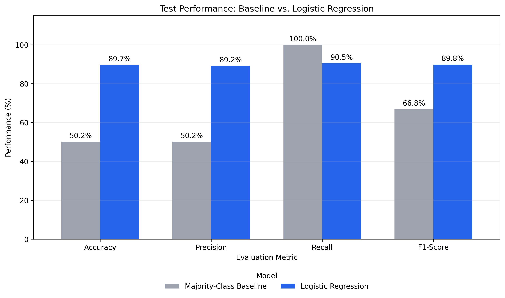
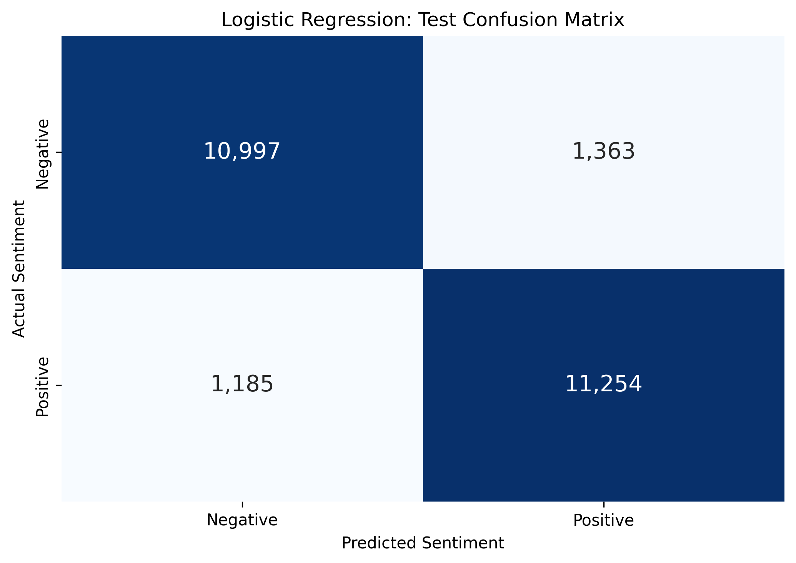
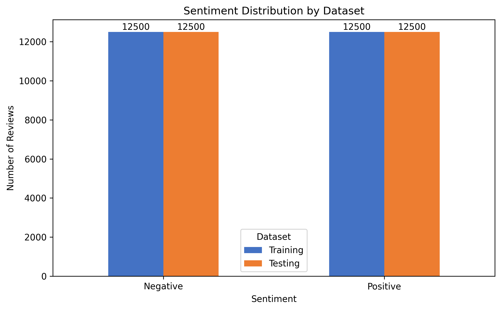
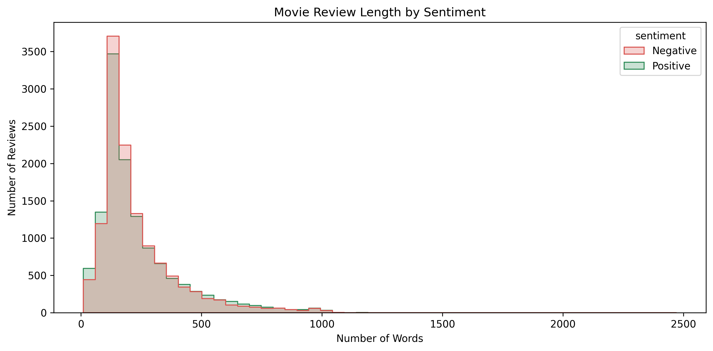

# Movie Review Sentiment Classification Using Machine Learning

**Course:** DSA 495  
**Component 3:** Documented GitHub Repository

## Team Members

- Prisha Shah
- Laura Botnaru
- Grishma Kuikel

## 1. Project Overview

The objective of this project is to classify written movie reviews as positive or negative using natural language processing (NLP) and machine learning.

### Research Question

How effectively can machine learning classify the sentiment of written movie reviews using TF-IDF and Logistic Regression?

### Background and Purpose

Reading and categorizing large numbers of reviews manually can be time-consuming. Sentiment analysis provides a way to automate this process and identify opinions within written text.

Through this project, we developed a complete Python workflow that collects, cleans, and prepares text data, trains a classification model, evaluates its performance, and examines incorrectly classified reviews.

### Success Criteria

Our goal was to develop a model that outperforms a majority-class baseline on movie reviews that were not used during training.

The Logistic Regression model successfully achieved this goal, with a testing accuracy of 89.73% compared to the baseline accuracy of 50.16%.

## 2. Dataset and Data Access

### Dataset Information

- **Dataset:** IMDb Large Movie Review Dataset
- **Original source:** Maas et al. (2011), Stanford AI Lab
- **Dataset access:** [Hugging Face](https://huggingface.co/datasets/stanfordnlp/imdb)
- **Original documentation:** [Stanford IMDb Dataset](https://ai.stanford.edu/~amaas/data/sentiment/)
- **Unit of analysis:** One movie review
- **Input variable:** Review text
- **Target variable:** Sentiment label
- **Label 0:** Negative sentiment
- **Label 1:** Positive sentiment

The original dataset contains:

- 25,000 labeled training reviews
- 25,000 labeled testing reviews
- 50,000 unlabeled reviews

Only the labeled reviews were used because this project focuses on supervised binary classification.

### Data Access

The dataset is retrieved programmatically using the Hugging Face `datasets` library:

```python
from datasets import load_dataset

dataset = load_dataset("stanfordnlp/imdb")
```

Users do not need to manually download the dataset. An internet connection is required when retrieving the data.

The full raw dataset is not included in this repository. Users should consult the original dataset documentation and applicable usage conditions before redistributing review text.

## 3. Project Workflow and Methodology

The project follows an end-to-end text classification workflow.

### Step 1: Data Collection and Exploration

- Loaded the IMDb dataset using Hugging Face.
- Examined the dataset structure and sentiment labels.
- Evaluated sentiment distributions and review lengths.
- Checked for missing values, duplicate reviews, and overlapping reviews.

### Step 2: Text Cleaning and Preparation

- Decoded HTML entities.
- Removed HTML tags and formatting.
- Converted text to lowercase.
- Removed unnecessary whitespace.
- Removed missing, empty, and duplicate reviews.
- Addressed overlapping reviews between training and testing datasets to reduce data leakage.

Stop words, including negation words such as "not" and "never," were retained because they can influence sentiment. Stemming and lemmatization were not applied to preserve the original wording.

### Step 3: Dataset Splitting

After cleaning and removing duplicate and overlapping reviews, the final dataset contained 49,578 labeled reviews.

| Dataset | Number of Reviews |
|---|---:|
| Training | 19,823 |
| Validation | 4,956 |
| Testing | 24,799 |
| **Total** | **49,578** |

A stratified 80/20 split was applied to the cleaned training dataset to create separate training and validation datasets.

The original testing split was retained for final evaluation after cleaning. A random seed of 42 was used to support reproducibility.

### Step 4: Feature Extraction

Term Frequency-Inverse Document Frequency (TF-IDF) was used to convert review text into numerical features.

The vectorizer:

- Used up to 30,000 features.
- Included unigrams and bigrams.
- Performed tokenization during feature extraction.
- Was fitted exclusively on the training dataset.
- Transformed the validation and testing datasets without refitting.

This approach reduces the risk of data leakage while capturing individual words and short phrases associated with sentiment.

### Step 5: Model Development

Two classification approaches were evaluated:

**Majority-Class Baseline**

A simple classifier that always predicts the most common sentiment class in the training dataset.

**Logistic Regression**

A supervised machine learning classifier trained using TF-IDF features to predict positive or negative sentiment.

Logistic Regression was selected because it is computationally efficient and well suited for high-dimensional text classification.

### Step 6: Evaluation and Interpretation

Both models were evaluated using:

- Accuracy
- Precision
- Recall
- F1-score

Additional evaluation included confusion matrix analysis, comparison of validation and testing performance, prediction confidence analysis, and examination of misclassified reviews.

## 4. Model Evaluation and Results

### Validation Performance

| Model | Accuracy | Precision | Recall | F1-Score |
|---|---:|---:|---:|---:|
| Majority-Class Baseline | 50.22% | 50.22% | 100.00% | 66.86% |
| Logistic Regression | 90.17% | 89.19% | 91.52% | 90.34% |

### Final Testing Performance

| Model | Accuracy | Precision | Recall | F1-Score |
|---|---:|---:|---:|---:|
| Majority-Class Baseline | 50.16% | 50.16% | 100.00% | 66.81% |
| Logistic Regression | **89.73%** | **89.20%** | 90.47% | **89.83%** |

Logistic Regression improved testing accuracy by 39.57 percentage points compared to the majority-class baseline.

Although the baseline achieved 100% recall by predicting every review as positive, Logistic Regression provided a substantially better balance between precision and recall.

The difference between validation and testing accuracy was only 0.44 percentage points, suggesting consistent performance on unseen IMDb movie reviews.

### Model Performance Comparison



### Confusion Matrix



| Classification Outcome | Number of Reviews |
|---|---:|
| True Negatives | 10,997 |
| False Positives | 1,363 |
| False Negatives | 1,185 |
| True Positives | 11,254 |
| **Total** | **24,799** |

The model correctly classified 22,251 out of 24,799 testing reviews.

### Exploratory Data Analysis

The following visualizations summarize the original dataset's sentiment distribution and review lengths.





The original dataset was balanced between positive and negative reviews. Review lengths overlapped considerably across both sentiment classes, suggesting that review length alone is unlikely to be a strong predictor of sentiment.

## 5. Error Analysis and Software Testing

### Error Analysis

The Logistic Regression model incorrectly classified 2,548 testing reviews, representing 10.27% of the testing dataset.

- False positives: 1,363
- False negatives: 1,185
- Average false-positive confidence: 62.98%
- Average false-negative confidence: 62.09%

Six high-confidence misclassified reviews were examined to identify potential reasons for classification errors.

The main findings included:

- Mixed positive and negative opinions within individual reviews.
- Changes in sentiment throughout a review.
- Limited understanding of context.
- Potential inconsistencies between review text and assigned labels.
- Differences between written opinions and numerical ratings.

Some incorrect predictions had confidence scores above 90%, demonstrating that high prediction confidence does not guarantee correctness.

Because only six high-confidence examples were examined, these findings should not be generalized to all misclassified reviews.

### Software Testing

The notebook includes checks for:

- Missing and empty text inputs.
- Whitespace and HTML formatting.
- Duplicate and overlapping reviews.
- Separation of training, validation, and testing data.
- Valid prediction labels and prediction counts.
- Confusion matrix totals.
- Classification of new sample reviews.

The model was also tested using four illustrative reviews containing positive sentiment, negative sentiment, mixed opinions, and negation.

All implemented software functionality checks passed successfully.

## 6. Repository Structure and Recommended Starting Point

The recommended starting point is the main analysis notebook:

**[movie_sentiment_analysis.ipynb](movie_sentiment_analysis.ipynb)**

This notebook contains the complete workflow from data collection through final evaluation and interpretation.

```text
DSA495-movie-review-sentiment/
│
├── README.md
├── topic_brief.md
├── movie_sentiment_analysis.ipynb
├── requirements.txt
│
├── figures/
│   ├── confusion_matrix.png
│   ├── model_performance_comparison.png
│   ├── review_lengths.png
│   └── sentiment_distribution.png
│
└── results/
    ├── baseline_validation_results.csv
    ├── confusion_matrix.csv
    ├── dataset_split_summary.csv
    ├── error_examples.csv
    ├── generalization_comparison.csv
    ├── misclassified_reviews.csv
    ├── review_length_summary.csv
    ├── sentiment_distribution.csv
    ├── test_model_comparison.csv
    └── validation_model_comparison.csv
```

### File and Folder Descriptions

| File or Folder | Description |
|---|---|
| `README.md` | Final project documentation and reproduction instructions |
| `topic_brief.md` | Original project proposal |
| `movie_sentiment_analysis.ipynb` | Complete Python analysis workflow |
| `requirements.txt` | Recorded Python package dependencies and versions |
| `figures/` | Saved visualizations supporting the analysis |
| `results/` | Saved evaluation metrics, summary statistics, and error analysis outputs |

## 7. Environment Setup and Reproduction Instructions

### Software Environment

The project was developed and tested using Google Colab.

- **Programming language:** Python 3.13.16
- **Development environment:** Google Colab
- **Random seed:** 42

### Required Packages

| Package | Version |
|---|---|
| datasets | 4.8.5 |
| pandas | 2.2.3 |
| numpy | 2.4.6 |
| scikit-learn | 1.6.1 |
| matplotlib | 3.10.0 |
| seaborn | 0.13.2 |

The package versions are also documented in `requirements.txt`.

### Reproducing the Analysis in Google Colab

1. Download or clone this GitHub repository.
2. Open [Google Colab](https://colab.research.google.com/).
3. Upload `movie_sentiment_analysis.ipynb`.
4. Upload `requirements.txt` to the Colab working directory.
5. Install the documented dependencies by running:

```python
%pip install -r requirements.txt
```

6. Restart the runtime if required after installing the packages.
7. Select **Runtime > Run all** to execute the notebook from beginning to end.
8. Allow the notebook to retrieve the IMDb dataset automatically.
9. Review the generated evaluation metrics, visualizations, and software testing results.

The notebook automatically creates the `figures/` and `results/` directories using relative paths and saves the generated outputs.

A GPU is not required for the modeling approach used in this project.

### Reproducibility Considerations

The notebook was successfully executed from beginning to end in Google Colab.

A fixed random seed, documented package versions, separate evaluation datasets, and relative file paths support reproducibility.

Exact results may vary if the dataset or software environment changes. The dataset revision is not currently pinned, and the workflow has not been independently tested in every Python environment.

## 8. Limitations and Responsible Use

### Model Limitations

- TF-IDF does not fully capture context, sarcasm, tone, or complex language.
- Reviews containing mixed opinions may be difficult to classify.
- Some dataset labels may not fully reflect the sentiment expressed in the review.
- The model only predicts positive or negative sentiment and does not include a neutral category.
- High prediction confidence does not guarantee an accurate prediction.
- Performance on other platforms or types of text has not been established.

### Responsible Use

This model is intended for educational purposes and general movie review sentiment analysis.

Predictions should not be treated as definitive interpretations of individual opinions. Human review is recommended when accurate sentiment interpretation is important.

The original dataset is retrieved from its source rather than including the complete raw dataset in the repository.

### Future Improvements

Future work could include:

- Evaluating a larger and more representative sample of misclassified reviews.
- Exploring models that better capture contextual meaning.
- Evaluating performance on reviews from other sources.
- Investigating additional approaches to mixed and neutral sentiment.

## 9. Conclusion

This project demonstrates that TF-IDF combined with Logistic Regression provides an effective approach to binary movie review sentiment classification.

The model achieved 89.73% testing accuracy and an F1-score of 89.83%, substantially outperforming the majority-class baseline.

The complete workflow demonstrates how natural language processing and machine learning can be used to transform raw text into interpretable predictions while recognizing the importance of evaluation, reproducibility, and responsible use.

## 10. References

Maas, A. L., Daly, R. E., Pham, P. T., Huang, D., Ng, A. Y., & Potts, C. (2011). Learning Word Vectors for Sentiment Analysis. Proceedings of the 49th Annual Meeting of the Association for Computational Linguistics.

- [Original IMDb Dataset](https://ai.stanford.edu/~amaas/data/sentiment/)
- [Hugging Face IMDb Dataset](https://huggingface.co/datasets/stanfordnlp/imdb)
- [Scikit-learn Documentation](https://scikit-learn.org/stable/)
- [Hugging Face Datasets Documentation](https://huggingface.co/docs/datasets/)

## 11. AI-Use Statement

We used ChatGPT to assist with project organization, code development, debugging, and interpretation of results. We reviewed and adapted its suggestions, tested the code in Google Colab, and evaluated the model using actual outputs. We take responsibility for the final analysis and findings.

## 12. Original Project Topic Brief

<details>
<summary>View Component 1: Original Topic Brief</summary>

The original topic brief documents our initial research question, proposed dataset, intended methodology, success criteria, and project planning.

[Read the complete original Topic Brief](topic_brief.md)

</details>
